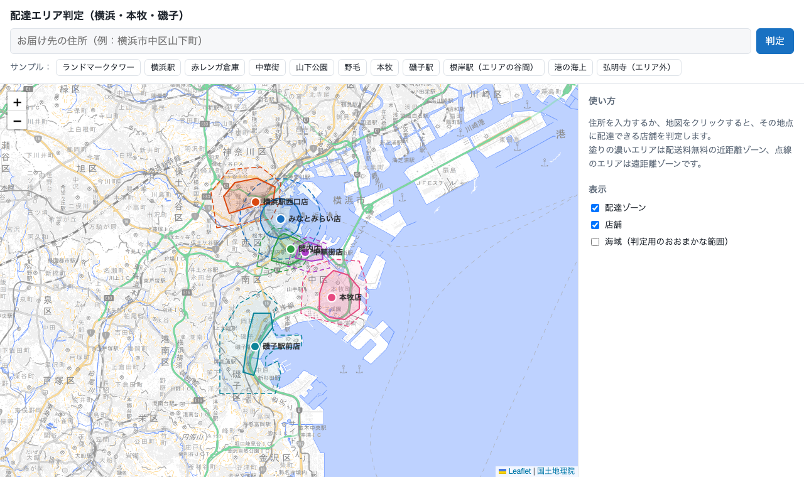
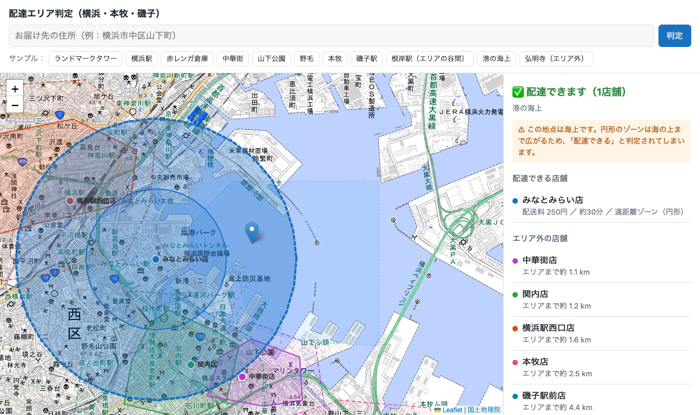
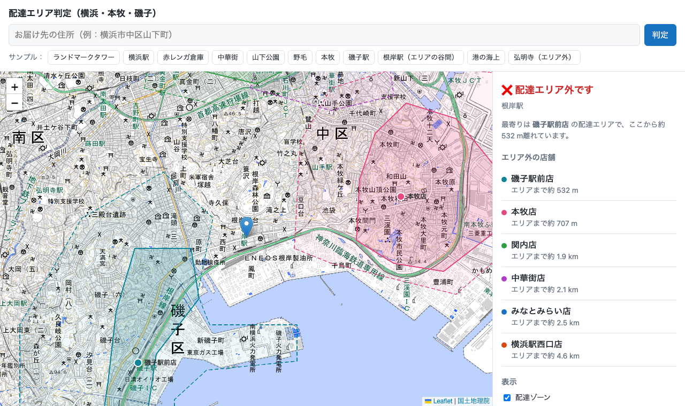

# delivery_area_demo

A delivery-area checker for central Yokohama, Honmoku, and Isogo, built to try point-in-polygon (PIP) queries in PostGIS.
Enter an address or click the map to see which (fictional) stores deliver to that point, at what fee.



| Circle zone accepts a point on the water | Out of range between two stores |
|---|---|
|  |  |

- **DB**: PostGIS 17-3.5 (`imresamu/postgis`, a multi-arch build; the official `postgis/postgis` image is amd64-only)
- **API**: FastAPI + psycopg 3, which also serves the frontend
- **Frontend**: Leaflet with GSI pale map tiles (`web/index.html`)
- **Geocoding**: the GSI address search API (no key needed), called from the backend

## Run

```bash
docker compose up -d --build
```

Open http://localhost:8100. The host ports are `API_PORT` (default 8100) and `DB_PORT` (default 5442).

Tests (integration, against the seeded DB):

```bash
docker compose --profile test run --rm --build test
```

To reset the DB after editing `db/init/*.sql`, run `docker compose down -v` and then start it again.

## Data model

| table | contents |
|---|---|
| `stores` | 6 fictional stores (Yokohama Sta. West, Minato Mirai, Kannai, Chinatown, Honmoku, Isogo Sta.) |
| `delivery_zones` | 2 overlapping zones per store: tier 1 is near and free, tier 2 is far and paid |
| `sea_areas` | rough outlines of Yokohama harbor and Negishi Bay, used to flag points on water |

All outlines are hand-drawn approximations of rivers and coastline:

- **Yokohama Sta. West**: the near zone stops at the Katabira River.
- **Minato Mirai**: deliberately plain `ST_Buffer` circles (1 km / 2 km), so they spill over the harbor.
- **Kannai**: the near zone is the east bank of the Ooka River, so Noge (on the west bank) gets the far-zone fee.
- **Chinatown**: the near zone keeps to the flat area, and the Yamate hill costs more.
- **Honmoku**: the near zone is the flat Honmoku lowland, and the hills to the west are far.
- **Isogo Sta.**: the near zone is the residential strip west of the JR line. The hills, Sugita, and the Shin-Isogo industrial peninsula are far.
- **Negishi Station** sits in a deliberate gap between the Isogo and Honmoku zones, so it shows the "nearest zone" distance.

The Honmoku/Isogo outlines were traced from GSI map tiles. The GSI reverse geocoder was no help here, because it returns "no address" for large reclaimed industrial land as well as for water.

## API

| endpoint | description |
|---|---|
| `GET /api/check?lat=&lon=` | best zone per covering store (sorted by fee), the distance to the nearest zone for the other stores, and an `on_water` flag |
| `GET /api/geocode?q=` | up to 5 candidates from GSI, with Yokohama hits first |
| `GET /api/zones`, `/api/stores`, `/api/sea` | GeoJSON FeatureCollections for the map |

The core query is in `api/main.py`. It uses `ST_Covers`, so an address exactly on a zone edge counts as inside, and `DISTINCT ON (store)` ordered by tier to pick each store's best zone.

## Things to try

`queries/explore.sql` contains:

1. a basic PIP lookup
2. `ST_Contains` vs `ST_Covers` on a boundary vertex (`f` / `t`)
3. the share of each zone that lies over the harbor (the circles are about 9–17%, the polygons about 0)
4. `EXPLAIN ANALYZE` showing the GiST index scan (a bbox `~` check, then the exact `st_covers` filter)

Run it with:

```bash
docker compose exec db psql -U demo -d delivery -f /queries/explore.sql
```

In the UI, the **港の海上** sample shows the circular zone accepting a point on the water, **野毛** shows the river-based tier split, and **根岸駅（エリアの谷間）** shows an out-of-range point between two stores.

## Deep links and screenshots

The page accepts `?lat=&lon=&label=&zoom=&sea=1`. It runs the check for that point on load, and `sea=1` turns on the water layer.
The README screenshots were taken from these links with headless Chrome:

```bash
"/Applications/Google Chrome.app/Contents/MacOS/Google Chrome" --headless=new --hide-scrollbars \
  --window-size=1280,760 --virtual-time-budget=20000 --screenshot=docs/images/harbor.png \
  'http://localhost:8100/?lat=35.4600&lon=139.6480&label=%E6%B8%AF%E3%81%AE%E6%B5%B7%E4%B8%8A&zoom=14&sea=1'
```

## Limitations

- GSI search matches addresses only. A landmark name such as 赤レンガ倉庫 can hit an unrelated place, so the UI warns when the top hit is outside Yokohama.
- The zone and sea outlines are approximate and meant for demonstration only.
